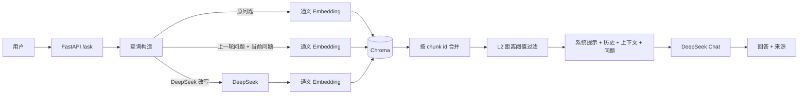

# RAG 个人知识库问答系统

基于 **FastAPI + Chroma + 通义 Embedding + DeepSeek** 的个人笔记检索问答服务。支持多轮追问、来源引用、无关片段过滤，并配套单轮 / 多轮 / 负样本三套检索评测。

## 项目简介

个人笔记分散在多个 Markdown 文件中，且包含大量截图。通用大模型无法直接基于这些私有文档作答，普通关键词搜索又难以处理换说法的问题。

本项目把笔记切分、向量化后存入 Chroma，在提问时检索相关片段，交给 DeepSeek 生成带来源的回答；并针对多轮追问中的指代丢失、无关片段误入上下文等问题做了检索链路优化。

## 主要功能

- Markdown 按标题层级切分，调用通义 `qwen3.7-text-embedding`（1024 维）写入 Chroma
- FastAPI 提供问答接口、会话查询/删除接口和同源聊天页面
- 多轮会话：按 `session_id` 保存最近 6 轮历史
- 来源引用：返回标题路径、内容摘要和 L2 距离
- 距离阈值过滤：过滤明显无关的片段，避免静默污染上下文
- 截图型笔记处理：识别只有图片的 chunk，提示模型图片内容不可读
- 多轮检索优化：原问题、历史拼接、LLM 改写三路检索，按 chunk 合并后过滤
- 无来源提示：没有笔记支撑时，回答开头明确说明“基于通用知识，未引用笔记”
- 检索评测：Hit@1 / Hit@5 / MRR / 来源覆盖率 / 误报率 / P50 / P95

## 架构



## 检索流程

1. **原问题检索**：直接对用户问题做 embedding。
2. **历史拼接**：如果当前问题是代词/省略型追问（如“他有什么好处”“那 HLOOKUP 呢”），把上一轮用户问题拼进检索 query。
3. **LLM 改写**：对依赖上下文的追问，用最近约 3 轮历史改写成独立问题，例如：
   - `那怎么改密码` → `Linux 怎么修改用户密码`
4. **合并候选**：三路检索结果按 chunk id 去重，保留距离更小的那条。
5. **距离过滤**：只保留 `distance <= RELEVANT_DISTANCE` 的片段。
6. **生成回答**：检索 query 只用于召回；发给模型的仍然是用户原始问题。

当前参数：

- `RELEVANT_DISTANCE = 1.0`（Chroma 默认 L2 空间）
- API 默认 `top_k = 2`，最大 10
- 每路检索内部最多取 5 个候选，合并后再截断到 `top_k`

## 评测结果

### 单轮检索：30 题

| 指标 | 数值 |
|---|---:|
| Hit@1 | 96.7% |
| Hit@5 | 100.0% |
| MRR | 0.983 |
| P50 | 0.191s |
| P95 | 0.460s |

### 多轮追问：20 题

| 策略 | Hit@1 | Hit@5 | MRR | 有来源率@2 |
|---|---:|---:|---:|---:|
| 基线（只用当前问题） | 70.0% | 90.0% | 0.787 | 85.0% |
| 历史拼接（单查询） | 90.0% | 100.0% | 0.929 | 100.0% |
| 双查询合并 | 90.0% | 100.0% | 0.950 | 100.0% |
| 双查 + LLM 改写 | 95.0% | 100.0% | 0.975 | 100.0% |

唯一的非 top-1 案例是 SUMIF 的父子章节：父章节排第 1、子章节排第 2，两条都相关且都在前 2，属于标题粒度导致的严格匹配误判。

### 查询改写延迟：17 条追问

| 指标 | 数值 |
|---|---:|
| P50 | 0.726s |
| P95 | 1.013s |
| 平均 | 0.767s |
| 最大 | 1.411s |

改写只对代词/省略型追问触发，独立问题不受影响。

### 负样本：10 题知识库外问题

| 指标 | 数值 |
|---|---:|
| 来源误报 | 0 / 10 |
| 误报率 | 0.0% |
| 最低最佳距离 | 1.1866 |

这说明当前阈值 1.0 是安全的；如果把阈值放宽到 1.2，部分负样本会开始误报。

## 设计取舍

- **没有上 rerank**：单轮 30 题 Hit@5 已经 100%，没有数据证明需要 rerank。多轮的非 top-1 案例两条都进了上下文，实际影响有限。
- **阈值保留 1.0**：负样本最低最佳距离是 1.1866，放宽到 1.2 会把无关内容放进来。优先用查询改写降低正样本距离，而不是放宽阈值。
- **改写只在追问时触发**：独立问题不调用改写，避免每轮多花约 1 秒。
- **没有做 OCR**：约 47/209 个 chunk 是截图型内容，当前会明确提示“图片不可读”，而不是假装看过截图。OCR 是后续可选的增强。
- **会话保存在内存**：单用户本地使用，重启会清空；没有引入 Redis 或数据库。
- **没有多用户和权限**：这是个人知识库，不做租户隔离。

## 项目结构

```text
rag-demo/
├── api.py                       # FastAPI 接口与页面路由
├── rag.py                       # 检索、改写、生成主流程
├── build_knowledge.py           # 笔记切分、embedding、写入 Chroma
├── requirements.txt
├── README.md
├── .env                         # API Key（不提交）
├── .env.example                 # 配置模板（提交）
├── static/
│   └── index.html               # 同源聊天页面
├── knowledge/                   # Markdown 笔记
├── chroma_db/                   # 本地向量库
├── eval/
│   ├── data/
│   │   ├── eval_set.json                # 单轮评测集（30 题）
│   │   ├── eval_set_multiturn.json      # 多轮评测集（20 题）
│   │   └── eval_negative.json           # 负样本评测集（10 题）
│   ├── scripts/
│   │   ├── eval_retrieval.py            # 单轮检索评测
│   │   ├── eval_multiturn.py            # 多轮检索评测（四种策略）
│   │   ├── eval_negative.py             # 来源误报评测
│   │   └── measure_rewrite_latency.py   # 改写延迟测量
│   └── reports/
│       ├── eval_report.md
│       ├── eval_results.json
│       ├── eval_multiturn_report.md
│       ├── eval_multiturn_results.json
│       ├── eval_negative_report.md
│       ├── eval_negative_results.json
│       ├── rewrite_latency_report.md
│       └── rewrite_latency_results.json
└── tools/
    ├── list_chunks.py           # 生成 chunk 清单
    ├── chunks.txt               # chunk 清单（辅助选题）
    ├── main.py                  # embedding 连通性测试
    └── search.py                # 早期检索脚本（保留参考）
```

## 快速开始

### 1. 安装依赖

```bash
pip install -r requirements.txt
```

### 2. 配置密钥

复制示例文件，然后填入自己的 Key：

Windows：

```bash
copy .env.example .env
```

macOS / Linux：

```bash
cp .env.example .env
```

`.env` 内容：

```text
DASHSCOPE_API_KEY=你的百炼 API Key
DEEPSEEK_API_KEY=你的 DeepSeek API Key
```

`.env` 已被 `.gitignore` 忽略，不会提交到 GitHub。

### 3. 构建知识库

把 Markdown 笔记放进 `knowledge/`，然后执行：

```bash
python -X utf8 build_knowledge.py
```

Windows 控制台建议加 `-X utf8`，否则笔记里的 emoji 可能触发 GBK 编码错误。

仓库默认不提交 `chroma_db/`，克隆后需要先运行一次建库脚本。`knowledge/` 会随仓库提交；如果笔记包含个人信息，请在推送前移除或替换成示例数据。

### 4. 启动服务

```bash
uvicorn api:app --reload
```

- 聊天页面：`http://127.0.0.1:8000/`
- 接口文档：`http://127.0.0.1:8000/docs`

### 5. 运行评测

```bash
python -X utf8 eval/scripts/eval_retrieval.py
python -X utf8 eval/scripts/eval_multiturn.py
python -X utf8 eval/scripts/eval_negative.py
python -X utf8 eval/scripts/measure_rewrite_latency.py
```

`eval_multiturn.py` 和 `measure_rewrite_latency.py` 会调用 DeepSeek 做查询改写；其余脚本只调用 embedding。报告统一写入 `eval/reports/`。

生成 chunk 清单（用于挑选评测问题）：

```bash
python -X utf8 tools/list_chunks.py
```

## API

### POST /ask

```json
{
  "question": "什么是继承",
  "session_id": "1",
  "top_k": 2
}
```

响应：

```json
{
  "answer": "继承是面向对象三大特征之一……",
  "sources": [
    {
      "title": "第一章-面向对象基础 > 2.面向对象特征介绍",
      "snippet": "三大特征 - 封装 - 继承 - 多态……",
      "distance": 0.3393
    }
  ],
  "session_id": "1"
}
```

### 其他接口

- `GET /sessions/{session_id}`：查看会话历史与轮数
- `DELETE /sessions/{session_id}`：清空会话历史
- `GET /health`：健康检查
- `GET /`：聊天页面
- `GET /docs`：Swagger 文档

## 已知限制

- 评测集规模较小（30 / 20 / 10），不适合判断 1～2 条样本的微小差异
- 命中判定使用标题完全匹配，父子章节会被判成“非 top-1”
- 来源是“检索到的候选”，尚未校验回答是否真的引用了它
- 截图型 chunk 只能提示“图片不可读”，没有 OCR
- 会话保存在进程内存，重启清空，不支持多进程共享
- 没有鉴权、限流和流式输出

## 后续计划

- 来源与回答一致性校验：只展示模型实际引用的来源
- SSE 流式输出，统计首 token 延迟
- 基于文件哈希的增量索引，避免全量重建
- 截图 OCR，提升图片型笔记的可检索性
- 扩充更难的换说法、多跳和跨轮评测样本
